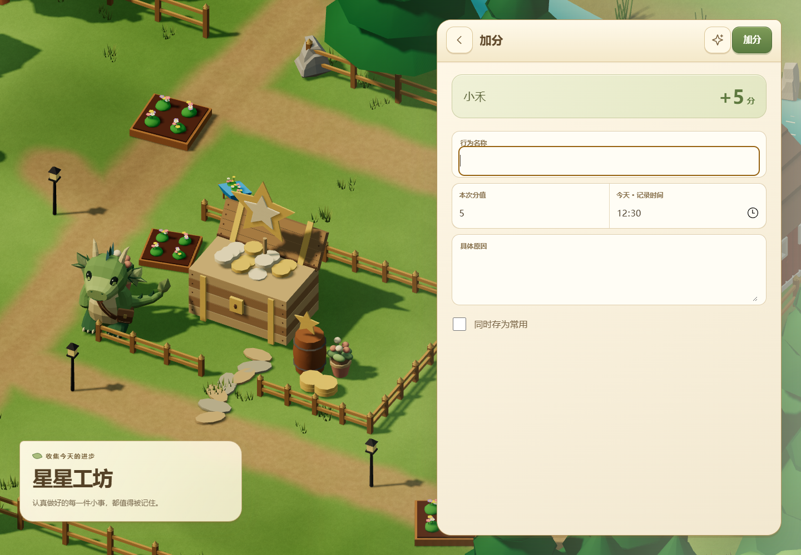
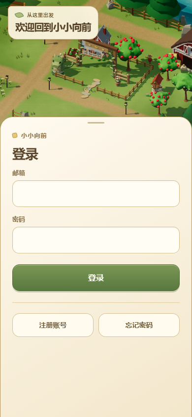

# 全站 Three.js 农场呈现

本次改造把首页以外的账号、家庭和业务功能放入与首页相同的 Three.js 农场世界。地点由当前界面状态选择；表单、确认、键盘焦点与服务器授权仍由原有宿主管理。没有改变积分、兑换、农场成长、家庭权限或 SQLite 数据格式。

## 功能地点

| 界面 | 地点 |
| --- | --- |
| 登录、注册、验证、找回密码及连接状态 | 农场入口 |
| 加分、行为选择与行为管理 | 星星工坊 |
| 提醒、新建/编辑事项、待处理 | 林间告示板 |
| 礼品、兑换申请、审批与礼品管理 | 心愿集市 |
| 积分记录与成长足迹 | 成长档案馆 |
| 伙伴、背包、补给及伙伴选择 | 伙伴营地 |
| 设置 | 小院管理屋 |
| 家庭、成员、孩子资料与家庭设置 | 家庭小屋 |
| 语音或文字指令 | 风车传话站 |
| 逐笔家长验证、密码与敏感账号确认 | 家长守护屋 |
| 首页与展开后的农场 | 原有可操作农场 |

## 实现与边界

- `farm/world-stations.js` 定义功能地点的三维实物，`farm/scene.js` 共享地形、光照、模型与资源释放机制。`presentation: farm` 保留原有农场模式。
- `world-ui.js` 依据业务表单或账号视图选择地点，提供场景状态、窄屏/侧栏遮挡测量与生命周期管理。它不发网络请求，不写业务状态或浏览器存储。
- `farm-world.css` 最后加载，统一木色边框、奶油纸面、草绿色按钮和金色重点。桌面并排呈现场景与操作区，窄屏把场景置于面板上方。
- 输入、列表、按钮和对话框使用语义化 HTML，保留键盘输入、读屏、焦点与触控。装饰场景不会进入对话框的 Tab 顺序；Three.js 不可用时操作仍可继续。
- 账号页面只展示匿名场景。退出或切换家庭时销毁场景并失效旧回调，不能沿用上一个家庭的伙伴或投影。功能地点之间复用 renderer；跨越可操作农场与功能地点时释放旧实例，全站最多保留一个 WebGL 实例。普通页面跳转在内存中保留农场的昼夜与镜头选择，家庭边界清理时一并清空。
- 系统减少动画偏好、后台暂停、页面恢复和窗口变化均传到 renderer。移动设备真实 GPU、Safari 与实体 iPad 仍需对应环境验收。

## 构建与验证

使用既有 `npm run build:farm` 构建 `farm-scene.js`；Three.js 仍为 `0.160.1`，无新增运行时 CDN、模型下载或依赖升级。两种 HTTP 服务仅增加新宿主与样式的静态白名单，不开放源码目录、数据目录或环境配置。

新增宿主回归入口为 `node --test test/world-ui.test.cjs`，场景消费链为 `node test/world-browser.cjs`。后者使用独立的合成 HTTP 家庭夹具，与 SaaS SQLite 回归分别报告，不能相互替代。

浏览器通过 `WORLD_TEST_CASE` 每次运行一个短组，缺省为 `points`。完整组列表为 `points`、`rewards`、`reminders`、`companion`、`settings`、`voice`、`lifecycle`、`fallback`、`layout-320`、`layout-390`、`layout-1440`；每组单独记录 checks、source hashes、截图与失败，不能把缺省一组称为全套通过。`TEST_ARTIFACT_DIR` 可指定本轮输出目录。

本次精确验证结果与环境限制见 [验证记录](threejs-verification.md)；执行中的日志与恢复记录位于工作树的私有 `data/threejs-refactor/`。

## 界面预览

以下均为本轮真实 Edge 截图，使用独立合成测试家庭。

