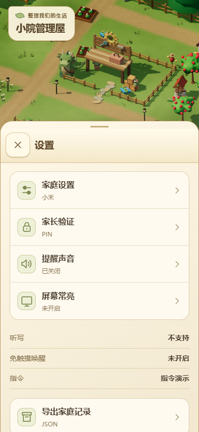

# 全站 Three.js 农场呈现

本次改造把首页以外的账号、家庭和业务功能放入与首页相同的 Three.js 农场世界。地点由当前界面状态选择；表单、确认、键盘焦点与服务器授权仍由原有宿主管理。没有改变积分、兑换、农场成长、家庭权限或 SQLite 数据格式。

## 功能地点

| 界面 | 地点 |
| --- | --- |
| 登录、注册、验证、找回密码及连接状态 | 农场入口 |
| 加分、行为选择与行为管理 | 星星工坊 |
| 提醒、新建/编辑事项、待处理 | 林间告示板 |
| 礼品、兑换申请、审批与礼品管理 | 心愿集市 |
| 积分记录与成长足迹 | 成长档案馆 |
| 伙伴、背包、补给及伙伴选择 | 伙伴营地 |
| 设置 | 小院管理屋 |
| 家庭、成员、孩子资料与家庭设置 | 家庭小屋 |
| 语音或文字指令 | 风车传话站 |
| 逐笔家长验证、密码与敏感账号确认 | 家长守护屋 |
| 首页与展开后的农场 | 原有可操作农场 |

## 实现与边界

- `farm/world-stations.js` 定义功能地点的三维实物，`farm/scene.js` 共享地形、光照、模型与资源释放机制。`presentation: farm` 保留原有农场模式。
- `world-ui.js` 依据业务表单或账号视图选择地点，提供场景状态、窄屏/侧栏遮挡测量与生命周期管理。它不发网络请求，不写业务状态或浏览器存储。
- `farm-world.css` 最后加载，统一木色边框、奶油纸面、草绿色按钮和金色重点。桌面并排呈现场景与操作区，窄屏把场景置于面板上方。
- 输入、列表、按钮和对话框使用语义化 HTML，保留键盘输入、读屏、焦点与触控。装饰场景不会进入对话框的 Tab 顺序；Three.js 不可用时操作仍可继续。
- 账号页面只展示匿名场景。退出或切换家庭时销毁场景并失效旧回调，不能沿用上一个家庭的伙伴或投影。功能地点之间复用 renderer；跨越可操作农场与功能地点时释放旧实例，全站最多保留一个 WebGL 实例。普通页面跳转在内存中保留农场的昼夜与镜头选择，家庭边界清理时一并清空。
- 系统减少动画偏好、后台暂停、页面恢复和窗口变化均传到 renderer。移动设备真实 GPU、Safari 与实体 iPad 仍需对应环境验收。

## 构建与验证

使用既有 `npm run build:farm` 构建 `farm-scene.js`；Three.js 仍为 `0.160.1`，无新增运行时 CDN、模型下载或依赖升级。两种 HTTP 服务仅增加新宿主与样式的静态白名单，不开放源码目录、数据目录或环境配置。

新增宿主回归入口为 `node --test test/world-ui.test.cjs`，场景消费链为 `node test/world-browser.cjs`。后者使用独立的合成 HTTP 家庭夹具，与 SaaS SQLite 回归分别报告，不能相互替代。

浏览器通过 `WORLD_TEST_CASE` 每次运行一个短组，缺省为 `points`。完整组列表为 `points`、`rewards`、`reminders`、`companion`、`settings`、`voice`、`lifecycle`、`fallback`、`layout-320`、`layout-390`、`layout-1440`；每组单独记录 checks、source hashes、截图与失败，不能把缺省一组称为全套通过。`TEST_ARTIFACT_DIR` 可指定本轮输出目录。

本次精确验证结果与环境限制见 [验证记录](threejs-verification.md)；执行中的日志与恢复记录位于工作树的私有 `data/threejs-refactor/`。

PR 审查修复的打包、WebGL 恢复、按钮对比度和跨盘截图回归见 [后续验证](threejs-pr3-fixes.md)。`test:world:contrast` 和分组的 `test:farm-context:browser` 为可重复入口；打包检查纳入 `test:saas`。

## 积分与表单体验调整

- 输入框采用单层边框、外置标签和约 48px 的输入高度。家长验证使用全局居中弹框，PIN 位于操作摘要前方并自动获得焦点；窄屏内容可滚动，确认按钮始终可达。
- 首页常用行为使用内容驱动的卡片行，单个项目不再占满剩余高度。“新建常用行为”使用编辑图标，“立即加分”使用星星与明确文字。
- 所有 `points.add` 入口先核对孩子、行为、分值及记录时间，再进入既有家长验证。核对和取消不发送记账请求；一次性授权、版本冲突及重试保持原有服务端校验。创建常用模板不产生积分。
- 礼品页提供“兑换记录”，直接选中现有账本的礼品兑换页签，返回保留礼品筛选。
- `farm/ui-effects.js` 创建真实 Three.js 星星宝箱，通过现有 WebGLRenderer 的 192×256 透明 render target 投影到装饰图片，不增加 WebGL 实例或页面 canvas。主数字显示历史总积分，独立标签显示可兑换积分，均通过 HTML 呈现；宝箱跟随历史总积分，兑换后保留累计成长。空闲装饰最多 6fps，成功反馈最多 12fps，减少动画模式使用静态反馈。只在记账成功后触发庆祝，家庭切换与销毁时清除图片并释放资源。
- 加分的行为名称与正整数分值必填，具体原因选填。确认页将空原因显示为“未填写”，加分记录显示“未填写原因”；手填与指令草稿共用相同业务规则，保存常用、服务端校验及历史重读均允许空原因。

对应验证入口为 `test:ui:flows`、`test:ui:layout` 和 `test:ui:credit`，各独立短组与选择变量见项目 `AGENTS.md`。它们分别验证真实 SaaS/SQLite 流程、合成 HTTP 界面布局和隔离的 WebGL 组件；不能把单组结果称作整套通过，也不替代实体 iPad/Safari 验收。

本轮结果与重启恢复记录见 [体验验证](ui-refinements-verification.md)。

## 界面预览

以下均为审查修复后更新的真实 Edge 截图，业务页使用独立合成测试家庭，登录页为临时 SaaS 服务的匿名页面。

